# Classified Multi-Vendor Ads Management Website

**Undergraduate graduation project · Hubei University of Technology · 2023**

**Author:** Muntasir Md Fahim  
**Project type:** Classified advertising / multi-vendor listing website  
**Academic deliverable:** Undergraduate thesis and documented website implementation

## Project overview

For my undergraduate graduation project, I worked on a classified ads website where visitors could browse and search listings, while registered users could post and manage their ads. This repository includes screenshots of the website, the system diagrams from my thesis, and the final report.

> **A note on the implementation:** My thesis discusses PHP/Laravel and Bootstrap, but the website files available for review show a **WordPress implementation using the Classima theme and plugins**. I have documented the website accordingly rather than presenting it as a custom Laravel application. The original thesis PDF is included without changes.

## Demonstrated features

- Classified advertisements and category-based browsing
- Keyword, location, and category search/filtering
- User registration and account interface
- Ad-submission form with item details and pricing
- Personal listing management, including editing and deleting ads

## Website screenshots

| Screen | Preview |
| --- | --- |
| Homepage / classified listing interface | 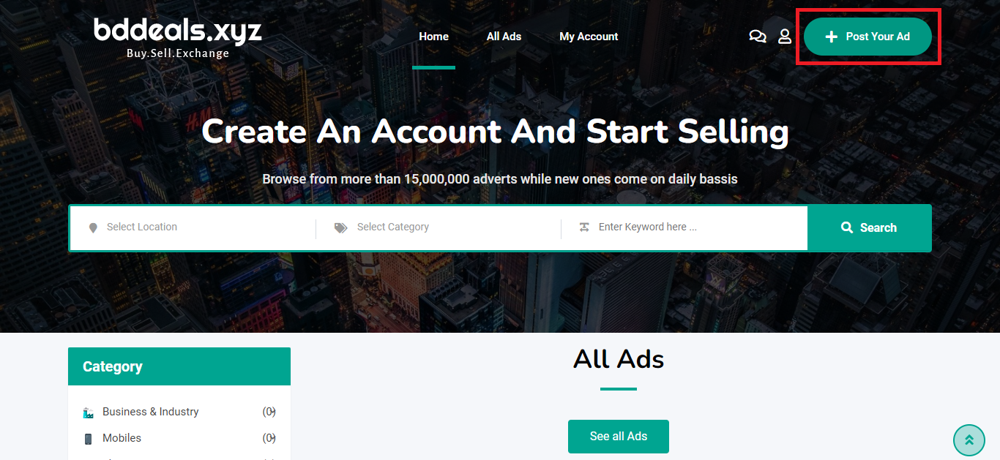 |
| Search and filters | 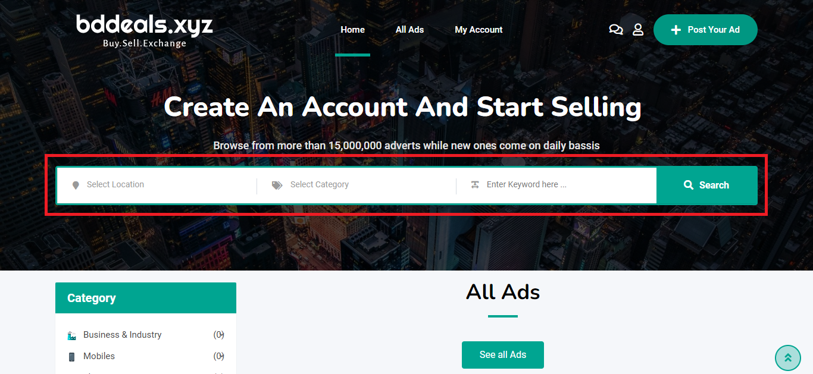 |
| Listing management | 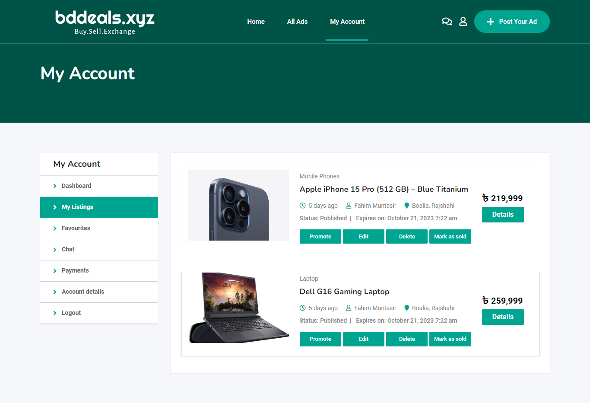 |
| Ad submission | 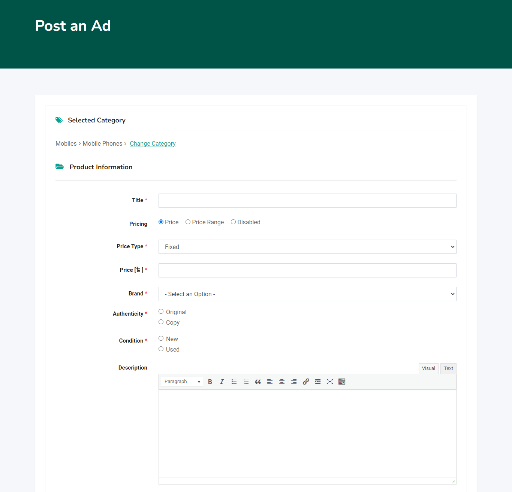 |
| Registration | 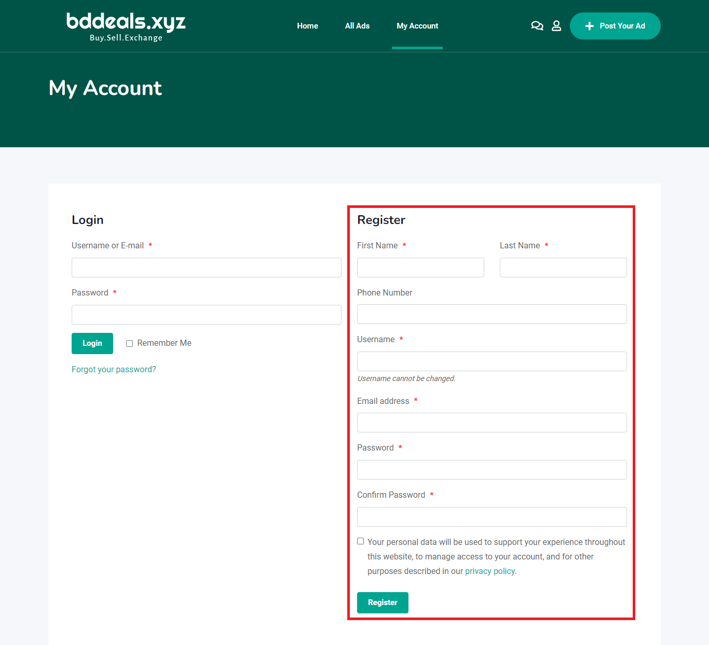 |
| Location filter | 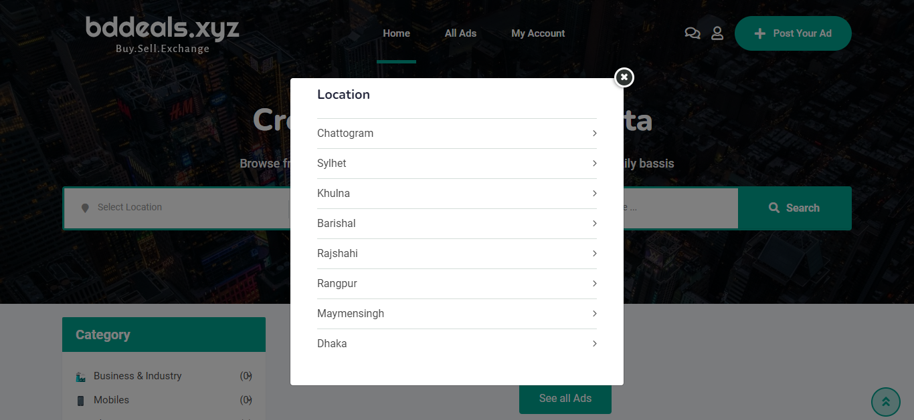 |

## System design diagrams

I prepared these diagrams for the thesis to explain the planned users, data, and processes. They do not represent the internal structure of WordPress or its plugins.

### Use case diagram
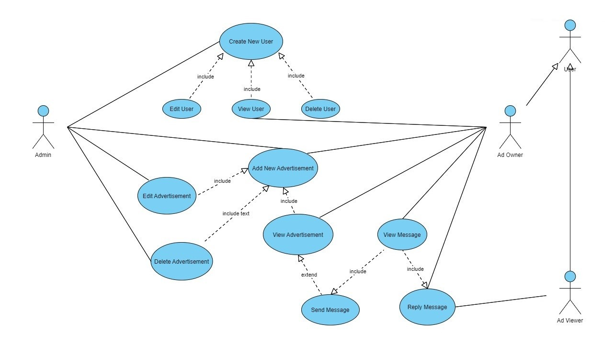

### Entity–relationship (ER) diagram
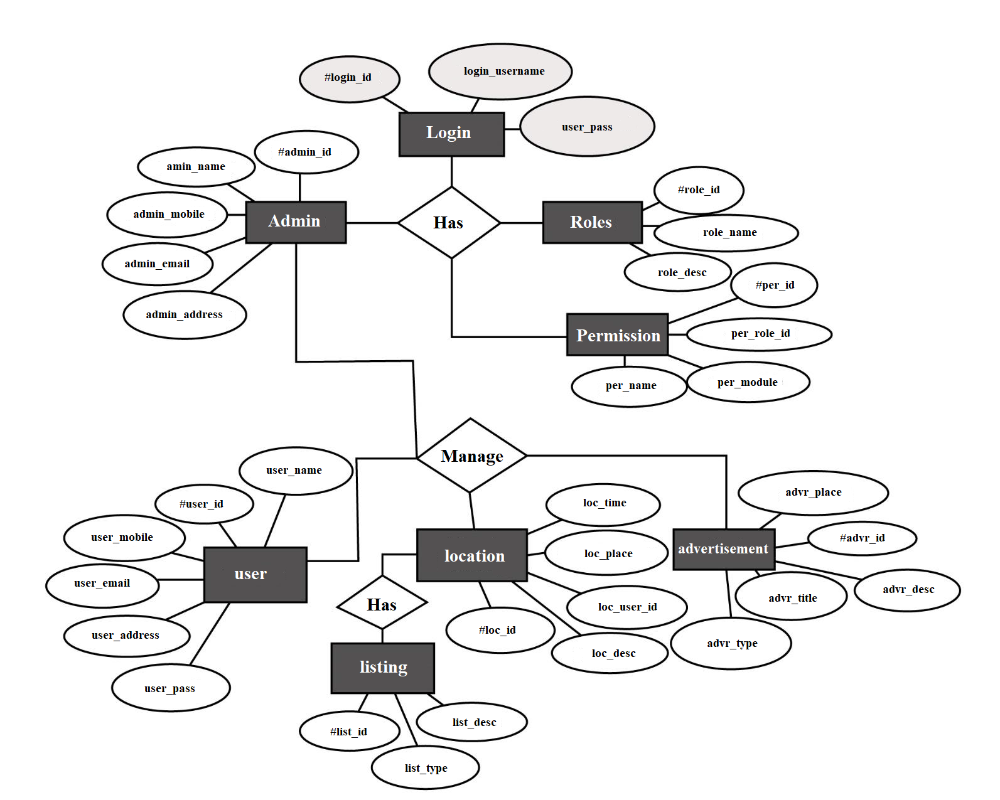

### Data flow diagram — Level 0 (context diagram)
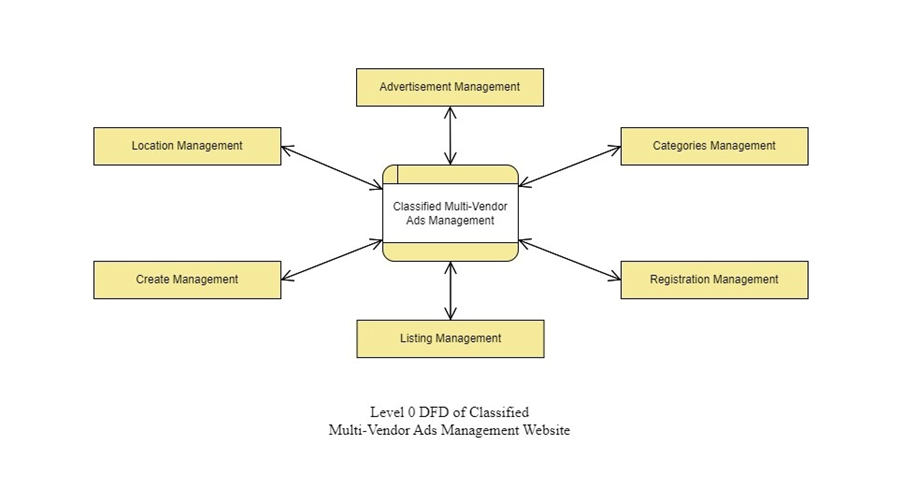

### Data flow diagram — Level 1
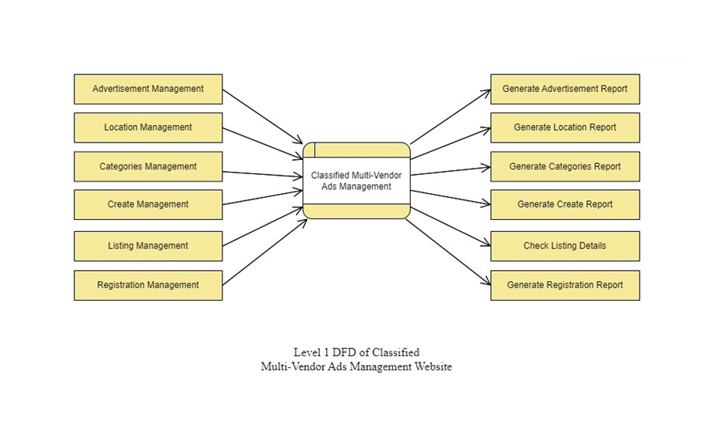

### Data flow diagram — Level 2
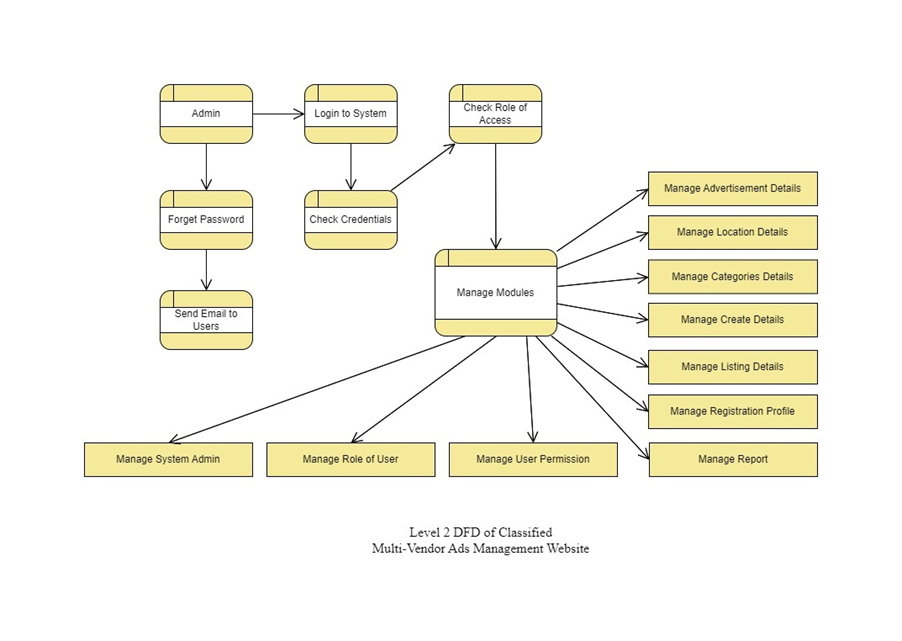

## Repository contents

```text
.
├── README.md
├── Undergraduate_Thesis.pdf
├── docs/
│   └── implementation.md
├── screenshots/
│   ├── homepage.png
│   ├── search-filters.png
│   ├── listing-management.png
│   ├── ad-submission.png
│   ├── registration.png
│   └── location-filter.png
└── diagrams/
    ├── use-case-diagram.jpg
    ├── er-diagram.png
    ├── dfd-level-0.png
    ├── dfd-level-1.png
    └── dfd-level-2.png
```

## Documentation

- [Website implementation and limitations](docs/implementation.md)
- [Original undergraduate thesis (PDF)](Undergraduate_Thesis.pdf)

## Reproducibility and scope

This repository is a record of my undergraduate project, not a complete website installation. It does not include the WordPress files, website database, paid theme or plugin packages, or hosting configuration needed to run the site. A live demo is not currently provided.

## Attribution

I completed this undergraduate project at **Hubei University of Technology in 2023**. WordPress, Classima, and the third-party plugins belong to their respective developers. I do not claim to have written their underlying code.
